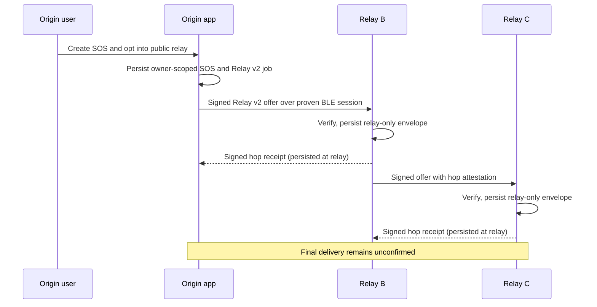
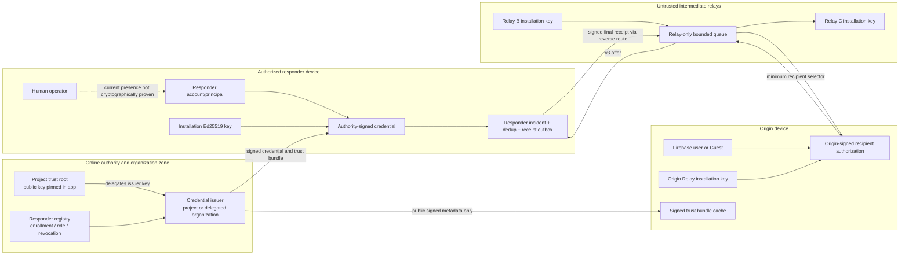
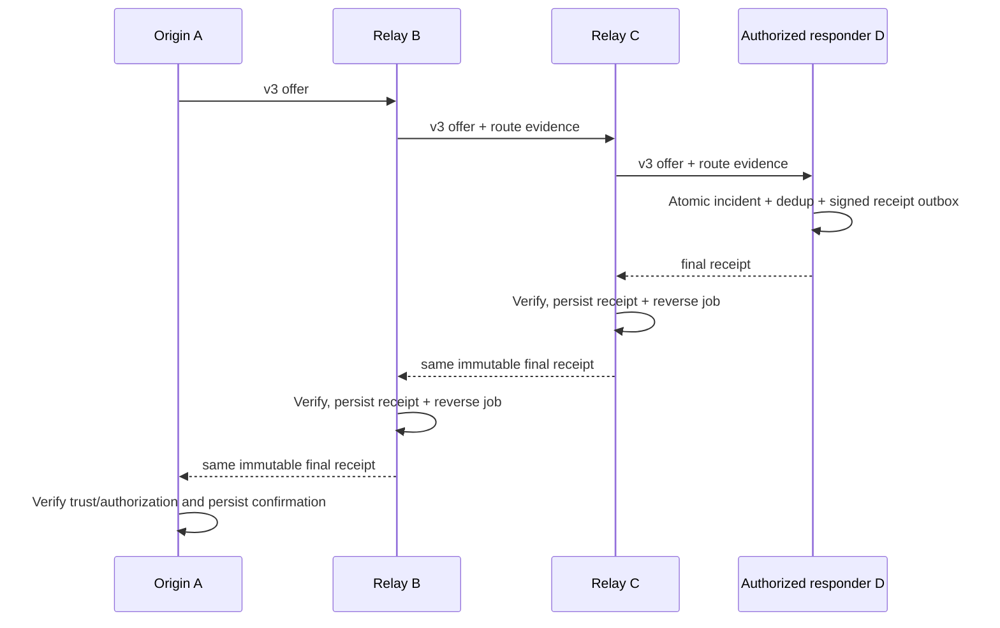
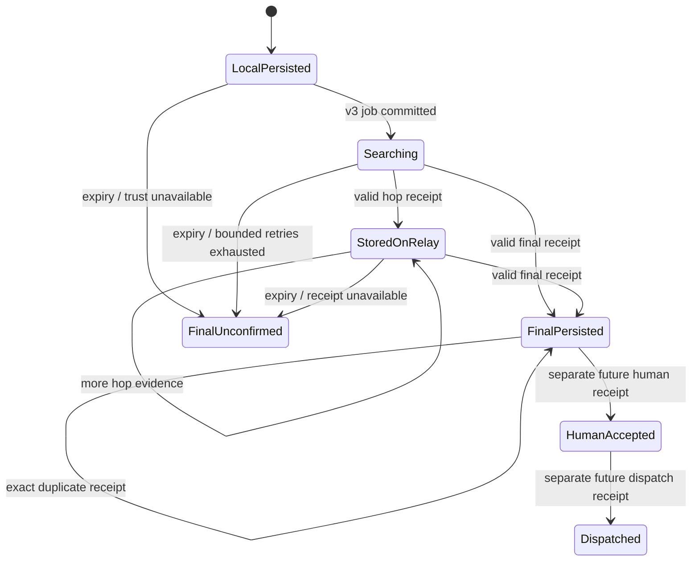
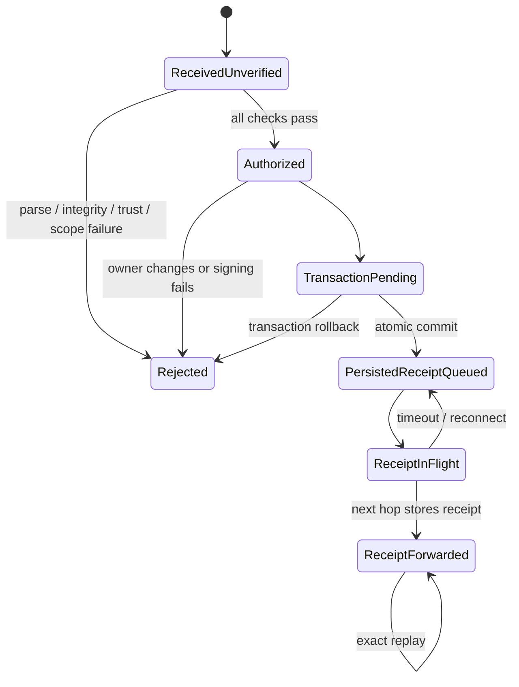

# Trusted Responder and Final Delivery Design

Design date: 2 November 2026 (Asia/Bangkok)

Repository: `off_grid_sos`

Baseline: `main` / `af6efe2cf4133de2c340d3cd374f9ee944d5b163`

Document status: **DESIGN ONLY — REVIEW REQUIRED — NOT IMPLEMENTED**

This document extends the current Direct BLE v1 and hop-only Relay v2 designs.
It does not authorize implementation, schema changes, backend deployment, or a
release claim.

## Decision labels

Every normative statement in this document carries one of these labels:

- **EXISTING** — confirmed in the current repository or recorded evidence.
- **PROPOSED** — recommended design; not present in production code.
- **OPEN DECISION** — product/security/operations approval is required.
- **NOT VERIFIED** — evidence is insufficient, especially on physical devices.

## Owner decision update — 2 November 2026

- **OWNER APPROVED:** Option A — Safe Minimal MVP is the current product
  direction. Direct BLE v1 and hop-only Relay v2 remain the implemented scope.
- **OWNER DEFERRED:** Final Delivery v3 is design material only. No v3 protocol,
  credential, enrollment, trust infrastructure, schema, or responder behavior
  is authorized by this decision.
- **BLOCKED:** Production Trust Authority, real responder enrollment/eligibility,
  and external operational ownership remain unresolved external dependencies.
- **EXISTING:** Relay v2 supplies hop-only storage evidence. It does not establish
  a real-world responder identity, final responder persistence, human acceptance,
  assistance dispatch, or arrival.
- **EXISTING:** The broader production release remains blocked by the release
  requirements recorded in `FINAL_PRODUCT_AUDIT.md` and release-readiness docs.
- This section records the later owner decision without rewriting the historical
  proposal and future architecture below.

## 1. Executive summary

- **EXISTING:** Direct BLE v1 uses application-level persisted ACKs, stable
  message identities, destination and observed-peer checks, durable retry, and
  duplicate suppression. Native write success is not delivery.
- **EXISTING:** Relay v2 provides an origin-signed public-emergency envelope,
  signed and session-bound hop receipts, foreground store-and-forward, bounded
  storage, 30-minute expiry, a three-hop maximum, and relay-only persistence.
- **EXISTING:** Relay participation is not responder authorization. A Relay v2
  key proves control of an installation key only, not a responder's identity,
  organization, role, or human action.
- **EXISTING:** `sos.relay.final_ack.v2` is structurally reserved, but the
  repository and coordinator explicitly reject it because no trusted principal
  or authenticated final-recipient authorization exists. It must not be enabled.
- **PROPOSED:** Add a separate capability and protocol generation named
  `sos.relay.final_delivery.v3`. It uses short-lived authority-signed responder
  credentials bound to the existing installation Ed25519 public key, an
  origin-signed recipient authorization, transactional final persistence, and
  a signed durable final persistence receipt.
- **PROPOSED:** Use a hybrid offline trust model: project-pinned public trust
  roots authorize project or organization issuers; devices cache signed,
  bounded trust bundles and credentials for offline verification. There is no
  shared application secret and no embedded private authority key.
- **PROPOSED:** A final responder persists an incident, semantic deduplication
  record, and signed receipt outbox atomically. Only a receipt recovered from
  that committed outbox can advance the origin to `finalPersisted`.
- **PROPOSED:** Machine persistence, human acceptance, and rescue dispatch are
  separate signed/state transitions. Final persistence never implies that a
  person read the incident or that assistance is coming.
- **OPEN DECISION:** The owner must approve the trust authority/operator,
  eligible organizations and roles, enrollment proof, offline credential
  validity window, recipient-selection policy, multi-responder fanout policy,
  displayed identity, retention, and incident escalation obligations.
- **NOT VERIFIED:** No backend authority, organization enrollment process,
  final-delivery schema, cross-platform v3 vectors, or physical
  A -> B -> authorized C -> B -> A final receipt exists today.

Recommendation: **do not implement the final ACK until the open decisions and
canonical v3 vectors are approved.** Preserve the current fail-closed behavior.

## 2. Current architecture and confirmed gaps

### 2.1 Actual identities and their assurance

| Identity | Status | Current representation | What it proves | What it does not prove |
|---|---|---|---|---|
| Firebase user | **EXISTING** | Firebase UID, owner-scoped repositories | Authenticated account and cloud ownership under current rules | Emergency responder eligibility or real-world identity |
| Guest/local owner | **EXISTING** | `guestDeviceOwnerId`, local-only owner scope | Local separation from authenticated accounts | Any external identity or authority |
| Responder principal | **PROPOSED** | Opaque authority-assigned principal ID | Enrolled responder subject under an issuer policy | The current human holding an unlocked device |
| Responder organization/role | **PROPOSED** | Credential claims using opaque organization ID and enumerated role/scope | Issuer-authorized role during credential validity | Current availability, acceptance, or dispatch |
| App installation | **EXISTING** | Native `deviceIdentity` in Direct v1 | Stable local installation routing/binding | Person or responder authority |
| BLE transport peer | **EXISTING** | Native connection/device ID and session role | Current transport route | Stable identity, account, or authorization |
| Relay installation | **EXISTING** | SHA-256 fingerprint of Ed25519 public key | Control of Relay v2 installation private key | Real person, organization, or responder status |
| Human operator | **NOT VERIFIED** | No current protocol claim | Nothing today | Reading, accepting, dispatching, or acting on an SOS |

### 2.2 Current data flow



- **EXISTING:** `SosRepository.create()` persists the normal owner-scoped SOS
  and cloud command transactionally, then invokes BLE enqueue. Guest cloud sync
  is disabled (`sos_repository.dart:120-188`, `311-317`).
- **EXISTING:** Direct v1 and Relay v2 are independent. Relay key-store failure
  fails Relay closed without disabling Direct v1 (`relay_key_store.dart:84-157`).
- **EXISTING:** Relay v2 origin data excludes account ID, contact data, Chat,
  Location Sharing streams/tokens, and cloud state
  (`relay_envelope.dart:38-88`).
- **EXISTING:** `RelayRepository.persistReceipt()` verifies the retained
  message/digest/time window and binds hop receipts to the selected attempt,
  next-hop key, and observed peer (`relay_repository.dart:965-1063`).
- **EXISTING:** Normal SOS History and relay-only storage are separate. Relay
  devices do not become responders by storing an envelope
  (`ble_relay_messages.dart:3-38`).
- **EXISTING:** Physical evidence in the release documents proves one fresh
  foreground A -> B -> C relay-only route and hop receipt, with zero History
  rows at B and C. It does not prove final delivery.

### 2.3 Confirmed gaps

| Gap | Status | Consequence |
|---|---|---|
| Responder enrollment and real authority | **EXISTING gap** | No device can prove it is allowed to become the final recipient |
| Credential bound to installation key | **EXISTING gap** | A Relay public key is self-asserted installation evidence only |
| Origin-signed recipient authorization | **EXISTING gap** | No final recipient can prove it was intended for this SOS |
| Offline issuer and revocation evidence | **EXISTING gap** | Offline authorization cannot be evaluated safely |
| Atomic responder incident + receipt outbox | **EXISTING gap** | No durable final-persistence proof can be created |
| Reverse receipt route | **EXISTING gap** | Hop receipts do not carry final evidence back to the origin |
| Human acceptance/dispatch protocol | **EXISTING gap** | Machine persistence cannot represent operational response |
| Owner-scoped responder storage design | **EXISTING gap** | Current `sos_messages.id` is globally primary-keyed, not `(ownerId,id)` |

## 3. Identity and trust boundaries



Trust-boundary rules:

1. **EXISTING:** BLE peer IDs are transport handles and may rotate. They are
   never accepted as responder principals.
2. **EXISTING:** Relay session proof demonstrates possession of the advertised
   installation private key in a specific connection generation. It does not
   authorize final persistence.
3. **PROPOSED:** The responder credential binds an authority-vetted principal,
   organization/role/scope, and installation public key. All must match.
4. **PROPOSED:** A human operator action is a distinct application event after
   final persistence. Unlocking or possessing the device is not sufficient
   evidence of human acceptance.
5. **PROPOSED:** Intermediate relays are untrusted for confidentiality and
   authorization decisions. They may validate integrity and bounded forwarding,
   but cannot widen recipient scope or mint final evidence.
6. **OPEN DECISION:** The product owner must define whether relay payload
   confidentiality against intermediate relays is required. Current Relay v2
   protects integrity, not end-to-end secrecy.

## 4. Trust-model comparison

| Model | Security guarantees | Offline behavior | Revocation | Operations/backend | Privacy | Guest compatibility | Public deployment |
|---|---|---|---|---|---|---|---|
| Server-issued responder credential | **PROPOSED option:** central authority verifies account/role and signs device-bound credential | Cached credential and pinned issuer key work until expiry | Central list/epoch; offline delay remains | Registry, enrollment, issuer/HSM, renewal, revocation feed | Authority sees enrollment; opaque IDs can limit relay exposure | Guest verifies signed evidence without authenticating | Good if authority governance and availability are strong |
| Organization-issued credential | **PROPOSED option:** organization attests its own responders | Works with cached organization issuer chain | Organization controls revocation; federation lag | Delegation, issuer onboarding, policy conformance, audit | Organization learns membership; origin sees selected claims | Guest can verify a pinned/delegated chain | Good for emergency services; complex federation |
| Explicit user trust/invitation | **PROPOSED option:** origin explicitly pins a known person's installation key | Excellent after invite exchange | Origin must remove/rotate trust; poor fleet response | Invite/recovery UX; little central infrastructure | Minimal central disclosure, but relationship metadata exists | Works for Guest if invite survives locally | Poor for unknown public responders; good for family/private use |
| Pre-provisioned controlled deployment | **PROPOSED option:** administrator installs credentials and roots on managed devices | Strong offline operation | Manual/MDM refresh; can be slow | Inventory, secure provisioning, device custody, reissue | Good within closed deployment | Guest origins need the deployment's public trust bundle | Strong for a fixed pilot; poor at public scale |
| Hybrid offline trust | **PROPOSED recommendation:** project root delegates issuers; device credential binds principal/role/key; cached signed trust bundle verifies offline | Strong but bounded by credential/bundle expiry | Online revocation plus short lifetime; known offline delay | Most complex: authority, organizations, bundle distribution, audit and recovery | Opaque claims and scoped selectors minimize disclosure | Guest needs no account; verifies signed credential and authorization locally | Best balance for public + controlled deployments |

### Recommendation

- **PROPOSED:** Adopt the hybrid offline model. Pin only public root keys and
  accepted algorithms/domains in the application. Keep authority private keys
  in an audited signing service or HSM, never in the app or repository.
- **PROPOSED:** Allow both project-issued credentials and explicitly delegated
  organization issuers under one validation policy. A credential is valid only
  if the full chain, scope, time window, key binding, and cached status evidence
  validate.
- **PROPOSED:** Keep explicit user invitations as a future private-target
  profile, not as the public-emergency trust basis. Mixing it into v3 would
  widen scope and complicate policy.
- **OPEN DECISION:** Approve the initial issuer. A solo developer-operated
  production authority without independent responder verification and audit is
  not an adequate public responder trust claim.

## 5. Credential lifecycle

### 5.1 Canonical responder credential

- **PROPOSED:** Wire kind `sos.responder.credential.v1` with exact-key,
  deterministic canonical JSON and Ed25519 issuer signature.
- **PROPOSED:** Required signed fields are:

```json
{
  "audience": "off_grid_sos.final_delivery.v3",
  "credentialId": "opaque-id",
  "credentialVersion": 1,
  "expiresAt": "UTC-RFC3339",
  "installationKeyId": "base64url-sha256-public-key",
  "installationPublicKey": "base64url-ed25519-public-key",
  "issuedAt": "UTC-RFC3339",
  "issuerId": "opaque-issuer-id",
  "kind": "sos.responder.credential.v1",
  "notBefore": "UTC-RFC3339",
  "organizationId": "opaque-organization-id",
  "principalId": "opaque-responder-principal-id",
  "roles": ["emergency_responder"],
  "schemaVersion": 1,
  "scopes": ["persist_public_emergency_sos"],
  "statusEpoch": 1
}
```

- **PROPOSED:** The signature is transmitted beside this exact object as
  `issuerKeyId` and `signature`. The signed bytes are UTF-8 of the canonical
  object prefixed by the fixed domain
  `off-grid-sos/responder-credential/v1\u0000`.
- **PROPOSED:** Arrays are sorted lexicographically and duplicate-free before
  signing. Numbers are integers only. Unknown/missing fields, duplicate JSON
  keys, non-canonical encodings, unsupported algorithms, and unsupported
  versions fail closed.
- **PROPOSED:** A `credentialDigest` is SHA-256 of the exact canonical signed
  object plus issuer key ID and signature. It binds the final receipt to the
  credential actually evaluated.
- **OPEN DECISION:** Approve whether organization and principal identifiers are
  globally stable opaque IDs or per-audience pairwise pseudonyms. Pairwise IDs
  reduce correlation and are recommended where operations permit.

### 5.2 Lifecycle steps

| Step | Design |
|---|---|
| Enrollment | **PROPOSED:** Authority or approved organization verifies the applicant and role using an owner-approved process; Firebase login is an account channel, not sufficient proof by itself. |
| Installation registration | **PROPOSED:** Device loads/creates the existing Relay Ed25519 key in secure storage, submits only its public key/key ID over authenticated online enrollment, and proves possession by signing a server nonce. |
| Issuance | **PROPOSED:** Issuer signs the canonical credential only after role, device, proof-of-possession, and policy checks. |
| Local storage | **PROPOSED:** Private seed stays in current Keystore/Keychain. Credentials and public trust bundles may be stored in an owner-scoped public metadata store; no private key is stored in Drift/cloud/logs. |
| Renewal | **PROPOSED:** Renew online before expiry with fresh account/role checks and installation-key proof. Renewal increments credential version or creates a new credential ID according to issuer policy. |
| Expiration | **PROPOSED:** Verification uses `min(credential.expiresAt, trustBundle.expiresAt, SOS.expiresAt)`. No indefinite offline grace. |
| Revocation | **PROPOSED:** Issuer publishes signed bounded status bundles containing revoked credential IDs/key IDs and a monotonically increasing status epoch. |
| Device replacement | **PROPOSED:** New device creates a new key and credential. The old credential/key is revoked. Private seed is never copied. |
| Account recovery | **PROPOSED:** Recovers the account, not the installation private key. Re-enrollment and new device credential are mandatory. |
| Multiple devices | **PROPOSED:** Each device has a distinct installation key and credential under the same principal; revocation can target one device. |
| Lost/compromised device | **PROPOSED:** Mark credential and key revoked, terminate sessions, issue status bundle, and re-enroll replacement. Offline acceptance risk persists only within approved freshness bounds. |
| Secure-storage failure | **PROPOSED:** Final delivery capability fails closed; Direct v1 and relay-only v2 remain available as today. No silent key regeneration for an enrolled responder. |

- **EXISTING:** Android uses Keystore-wrapped AES-GCM secure storage with
  backup migration disabled. iOS uses non-synchronizing
  `unlocked_this_device` Keychain access (`relay_key_store.dart:14-69`).
- **NOT VERIFIED:** Hardware-backed key isolation/attestation, behavior after OS
  restore, jailbreak/root resistance, device lock transitions, and real
  secure-storage failure still require platform/device evidence.
- **OPEN DECISION:** Approve credential lifetime, trust-bundle lifetime, and
  incident-clock policy. Recommended starting limits are 24 hours for a device
  credential and 6 hours for a status bundle, with no stale grace; these values
  are not approved production policy.

## 6. SOS recipient authorization

### 6.1 Authorization object

- **PROPOSED:** Do not mutate Relay v2 bodies or activate its reserved final
  receipt. Introduce `RelayOriginBodyV3` and capability
  `sos.relay.final_delivery.v3`.
- **PROPOSED:** The origin signs a `FinalDeliveryAuthorizationV1` whose digest is
  included in the immutable v3 origin body. Required fields:
  `authorizationId`, `authorizationRevision`, `originMessageId`, `incidentId`,
  `immutableEmergencyDigest`, `selectorType`, `selectorValue`, `requiredRole`,
  `requiredScope`, `allowedIssuerIds`, `correlationId`, `notBefore`, `expiresAt`,
  and `maximumFinalRecipients`.
- **PROPOSED:** Supported initial selector types are:
  `specificPrincipal`, `organizationRole`, and `anyTrustedResponder`.
  `specificPrincipal` contains an opaque authority ID, not contact details.
- **PROPOSED:** A Guest origin can authorize a responder because it verifies
  public authority evidence locally; the Guest does not authenticate to the
  responder authority at emergency time. The responder learns only that an
  installation signed the SOS, not the Guest's real identity.
- **PROPOSED:** Relay nodes receive only the selector type, opaque selector or
  selector digest, required role/scope, issuer allowlist, expiry, and correlation
  needed for routing/verification. No account UID, name, email, phone, Chat
  token, cloud token, or contact record is added.
- **PROPOSED:** A recipient is eligible only when all of these match:
  origin signature; authorization signature/digest; credential chain; audience;
  issuer allowlist; principal/organization selector; role; scope; installation
  key; time/status policy; and local authenticated owner session.
- **PROPOSED:** Discovery ranks only peers that advertise the new capability,
  but an advertisement is not authorization. Full signed evidence and session
  proof are required before final persistence.
- **PROPOSED:** The first discovered BLE peer is never selected merely by
  proximity or RSSI.

### 6.2 Selection and fanout

| Question | Decision |
|---|---|
| Specific responder? | **PROPOSED:** Allowed only when a cached authority identity exists and the user explicitly chooses it. |
| Organization or role? | **PROPOSED:** Allowed using opaque organization/role selector and approved issuer set. |
| Multiple authorized responders? | **PROPOSED:** Bounded multi-path delivery may be allowed. The first valid final-persistence receipt confirms machine persistence; subsequent valid receipts remain separate evidence and do not create duplicates on one responder. |
| Arbitrary nearby device? | **PROPOSED:** Rejected even if it supports Relay v2 or controls a valid installation key. |
| Intended responder offline? | **PROPOSED:** Relays retain bounded v3 work until SOS expiry. UI remains `Final delivery unconfirmed`; there is no fail-open fallback. |
| Recipient change after queue? | **PROPOSED:** Do not modify an immutable authorization. Create a new authorization revision and new origin message/delivery ID linked to the same incident; old and new receipt semantic keys remain disjoint. |
| Cancel old authorization? | **OPEN DECISION:** Define a signed cancellation/tombstone propagation policy. Expiry is the only safe default if cancellation cannot reach offline relays. |
| Maximum fanout | **OPEN DECISION:** Approve a bounded value and whether it varies by organization/incident type. Default recommendation: one final persistence for v3 pilot. |

## 7. Final responder persistence

### 7.1 Processing sequence

```mermaid
sequenceDiagram
    participant P as Previous relay/peer
    participant V as Final verifier
    participant K as Secure key service
    participant D as Drift transaction
    participant Q as Final receipt outbox

    P->>V: v3 offer + authorization + credential evidence
    V->>V: Canonical parse; origin/hop/path/time/limit checks
    V->>V: Verify trust chain, status bundle, selector, role, scope
    V->>V: Bind immediate peer to proven Relay session and route
    V->>V: Check semantic replay/conflict and current owner session
    V->>K: Sign deterministic final receipt
    K-->>V: Ed25519 signature or fail closed
    V->>D: BEGIN IMMEDIATE transaction
    D->>D: Insert responder incident (or exact duplicate check)
    D->>D: Insert final-delivery dedup record
    D->>Q: Insert signed final receipt + reverse-route job
    D-->>V: COMMIT succeeds
    V-->>P: Send receipt from committed outbox
    Note over V,P: Native write alone never advances delivery state
```

1. **PROPOSED:** Parse only canonical, exact-key supported versions and reject
   malformed/unknown inputs before storage.
2. **PROPOSED:** Verify origin signature, every hop attestation, immutable
   digest, path uniqueness, expiry, maximum hops, byte/storage limits, and
   location consent/range.
3. **PROPOSED:** Verify credential chain, current bounded status bundle,
   credential/key binding, responder owner session, selector, role and scope.
4. **PROPOSED:** Verify immediate transport peer through the existing proven
   Relay session. This is route evidence, not responder identity.
5. **PROPOSED:** Build and sign the deterministic final receipt before the
   transaction. If secure storage or signing fails, persist no incident.
6. **PROPOSED:** In one database transaction insert the responder-owned
   incident, semantic dedup record, exact credential/authorization evidence
   digest, signed receipt, and durable reverse-route outbox.
7. **PROPOSED:** Send only the exact receipt read from the committed outbox.
8. **PROPOSED:** Intermediate relays continue storing relay-only rows. Only a
   credential-authorized final responder transaction creates responder History.

### 7.2 Additive storage design (future schema v7 or later)

| Proposed table | Purpose / keys |
|---|---|
| `responder_credentials` | **PROPOSED:** public credential cache keyed by credential ID/version/digest, owner and installation key; never private seed |
| `responder_trust_bundles` | **PROPOSED:** bounded signed issuer/status metadata with issued/expiry/status epoch |
| `final_delivery_authorizations` | **PROPOSED:** origin authorization and immutable digest keyed by authorization ID/revision |
| `trusted_responder_incidents` | **PROPOSED:** responder-owned received incident keyed by local record ID with unique `(ownerId, originMessageId, immutableDigest, authorizationId)` |
| `final_delivery_dedup` | **PROPOSED:** semantic identity, credential/principal/key/digest and committed responder record ID |
| `final_receipt_outbox` | **PROPOSED:** exact canonical signed receipt, reverse route, bounded retry/expiry/state |
| `final_receipt_routes` | **PROPOSED:** durable immediate previous-hop key/device/session-generation evidence per receipt route |

- **PROPOSED:** Do not insert remote responder incidents directly into current
  `sos_messages` until owner-scoped key and UI/cloud implications are resolved.
  Its current primary key is only `id` (`sos_messages.dart:3-25`). A dedicated
  additive table avoids cross-owner collision and accidental cloud sync.
- **OPEN DECISION:** Approve whether the dedicated responder table becomes the
  long-term model or a later migration changes normal incident identity to a
  composite key. The latter has materially higher migration risk.
- **PROPOSED:** Never enqueue a received final incident to existing origin cloud
  sync automatically. A separate responder backend sync policy requires its
  own authorization and privacy review.

### 7.3 Crash and partial-failure analysis

| Failure point | Required outcome |
|---|---|
| Before verification | **PROPOSED:** no incident, dedup, or receipt; retain/retry relay work within expiry |
| Credential/signature failure | **PROPOSED:** fail closed, record only redacted diagnostic category, do not ACK final |
| Before transaction / signing failure | **PROPOSED:** no database mutation; Relay v2 remains intact |
| Mid-transaction crash | **PROPOSED:** SQLite rollback leaves no partial final state |
| Commit succeeds, app crashes before send | **PROPOSED:** receipt outbox survives and retries after restart with identical receipt ID/signature |
| Native send succeeds, transport callback lost | **PROPOSED:** resend exact receipt; semantic dedup makes it idempotent |
| Exact duplicate offer | **PROPOSED:** return committed receipt from outbox; do not create another incident |
| Same semantic ID, conflicting content | **PROPOSED:** fail closed, preserve first committed evidence, surface security diagnostic |
| Owner/account changes during operation | **PROPOSED:** transaction includes current-owner/generation fence and aborts on mismatch |
| Receipt expires before reverse delivery | **PROPOSED:** origin remains unconfirmed; responder incident remains locally persisted with expired receipt evidence |

## 8. Final ACK v3 protocol

### 8.1 Wire kind and canonical payload

- **PROPOSED:** New capability: `sos.relay.final_delivery.v3`.
- **PROPOSED:** New message kind: `sos.relay.final_persistence_receipt.v3`.
- **PROPOSED:** The reserved `sos.relay.final_ack.v2` remains rejected and is
  never reinterpreted.
- **PROPOSED:** Exact unsigned canonical object:

```json
{
  "authorizationId": "opaque-id",
  "authorizationRevision": 1,
  "authorizationScope": "specificPrincipal|organizationRole|anyTrustedResponder",
  "correlationId": "origin-generated-id",
  "createdAt": "UTC-RFC3339",
  "credentialDigest": "base64url-sha256",
  "credentialId": "opaque-id",
  "credentialVersion": 1,
  "expiresAt": "UTC-RFC3339",
  "immutableOriginDigest": "base64url-sha256",
  "incidentId": "origin-incident-id",
  "kind": "sos.relay.final_persistence_receipt.v3",
  "originMessageId": "origin-message-id",
  "persistenceRecordId": "opaque-local-record-id",
  "persistenceStatus": "persisted",
  "receiptId": "deterministic-id",
  "recipientSelectorDigest": "base64url-sha256",
  "responderInstallationKeyId": "base64url-sha256-public-key",
  "responderInstallationPublicKey": "base64url-ed25519-public-key",
  "responderOrganizationId": "opaque-or-null",
  "responderPrincipalId": "opaque-id",
  "responderRole": "emergency_responder",
  "routeContextDigest": "base64url-sha256",
  "schemaVersion": 3
}
```

- **PROPOSED:** `responderOrganizationId` is a required key whose value may be
  JSON `null`; exact keys prevent ambiguous optional-field encodings.
- **PROPOSED:** Sign UTF-8 bytes of
  `off-grid-sos/final-persistence-receipt/v3\u0000` followed by canonical JSON
  using the installation Ed25519 key bound by the credential. Transmit the
  object plus a required `signature` field. Ed25519 is fixed for v3; algorithm
  negotiation is not accepted.
- **PROPOSED:** `receiptId` is deterministic:
  `base64url(SHA-256(domain || originMessageId || immutableOriginDigest ||
  authorizationId || authorizationRevision || responderPrincipalId ||
  responderInstallationKeyId || persistenceRecordId))` using length-prefixed
  UTF-8 components.
- **PROPOSED:** `routeContextDigest` hashes the origin correlation, immediate
  inbound proven peer key, authorization ID, and immutable route/path evidence.
  It must not expose native peer IDs on the wire.
- **PROPOSED:** Canonical JSON reuses current recursive key sorting and exact
  parsing, but v3 forbids floating-point fields. Golden vectors must be tested
  in Dart and independently in each backend/native verifier before release.

### 8.2 Origin verification algorithm

The origin advances to final persistence only when all checks pass:

1. **PROPOSED:** Exact kind `sos.relay.final_persistence_receipt.v3`, schema 3,
   canonical encoding, fixed signature domain and supported capability.
2. **PROPOSED:** Exact retained `originMessageId`, `incidentId`, immutable
   origin digest, authorization ID/revision and correlation ID.
3. **PROPOSED:** Exact recipient selector digest and scope authorized by the
   origin; no widening from specific to organization/any.
4. **PROPOSED:** Credential ID/version/digest resolves to a valid chain under a
   pinned/delegated issuer and matches principal, organization, role, scope,
   installation public key and key ID.
5. **PROPOSED:** Credential/status bundle/receipt/SOS are all within their time
   windows under the approved clock policy.
6. **PROPOSED:** Receipt signature verifies with the credential-bound key.
7. **PROPOSED:** Persistence status is exactly `persisted`; no other string is
   treated as success.
8. **PROPOSED:** Receipt semantic identity has not appeared with conflicting
   bytes; exact replay is idempotent.
9. **PROPOSED:** Immediate source peer is a proven Relay session and matches the
   stored reverse-route job. The origin does not incorrectly require that this
   transport peer be the final responder—the last relay may deliver it.
10. **PROPOSED:** Persist the verified receipt and origin status atomically
    before displaying confirmed final persistence.

### 8.3 State semantics

| State | Evidence | User meaning |
|---|---|---|
| Stored on relay | **EXISTING:** valid hop receipt | One relay installation persisted it; no responder proof |
| Received by final device | **PROPOSED:** transport/session event only | Device received bytes; not durable and not success |
| Persisted by authorized responder | **PROPOSED:** verified v3 final persistence receipt | Authorized responder installation durably stored one incident |
| Human accepted | **PROPOSED future:** separate authenticated human action/receipt | A human explicitly accepted responsibility |
| Assistance dispatched | **PROPOSED future:** separate operational action/receipt | Organization recorded dispatch; does not prove arrival |
| Assistance arrived/resolved | **PROPOSED future:** separate operational evidence | Must never be inferred from earlier states |

- **PROPOSED:** Terminal human/dispatch states must use separate message kinds,
  authorization rules, and audit semantics. They are outside v3 scope.

## 9. Offline verification and reverse routing

### 9.1 Trust bundle and time policy

- **PROPOSED:** A signed bounded `ResponderTrustBundleV1` contains issuer public
  keys/delegations, status epoch, revoked credential/key IDs, issued time, next
  update, expiry, policy version, and authority signature.
- **PROPOSED:** Cache only the latest valid bundle per issuer plus one previous
  bundle for atomic replacement/rollback diagnostics. Apply explicit byte/count
  quotas; never allow unbounded revocation lists.
- **PROPOSED:** Trust verification fails closed when the required bundle or
  credential is absent, expired, rolled back, malformed, or outside policy.
- **PROPOSED:** Reuse the existing two-minute message clock-skew ceiling unless
  security review approves a distinct credential skew. Persist the highest
  observed signed authority time/status epoch to detect rollback.
- **PROPOSED:** Device wall-clock uncertainty beyond policy blocks new final
  persistence but does not erase relay-only evidence or Direct v1 behavior.
- **OPEN DECISION:** Full revocation lists may exceed mobile quotas. Approve
  status-list partitioning, compressed Merkle proofs, or short-lived
  credentials. No design may silently drop revocations to fit storage.
- **EXISTING limitation:** Instant revocation cannot be known while offline.
  Short validity bounds but does not eliminate the stolen-device window.

### 9.2 Durable reverse path



- **PROPOSED:** Every forward acceptance stores the previous-hop installation
  key, local transport handle, session generation/binding, correlation, and
  expiry as local route metadata. Native handles are never trusted globally.
- **PROPOSED:** The final device creates one immutable signed receipt. Relays
  verify and forward that same receipt; they never re-sign it as final.
- **PROPOSED:** Each relay persists receipt + reverse outbox before acknowledging
  its next hop. Retry is bounded by the original SOS/receipt expiry and existing
  storage quotas. No indefinite retry is introduced.
- **PROPOSED:** If the original reverse peer is unavailable, a relay may use
  another cryptographically validated route only when it leads to the retained
  origin key and exact authorization/correlation. Route substitution never
  changes receipt content.
- **PROPOSED:** App restart recovers committed reverse jobs. Expired jobs are
  removed by bounded cleanup; origin remains `Final delivery unconfirmed`.
- **PROPOSED:** Exact duplicate receipts are idempotent. Same semantic identity
  with different canonical bytes/signature is a conflict and fails closed.
- **OPEN DECISION:** Approve whether alternate reverse routing is included in
  initial v3 or whether the pilot retries only the recorded reverse chain. The
  latter is safer and recommended first.

## 10. State machines and failure transitions

### 10.1 Origin delivery state



- **PROPOSED:** Invalid, wrong-recipient, wrong-peer, expired, revoked, or
  conflicting receipts do not change the current state.
- **PROPOSED:** A delayed hop receipt cannot regress `FinalPersisted`.
- **PROPOSED:** `FinalUnconfirmed` is an evidence state, not proof of failure to
  reach any device. It means no valid final receipt arrived within policy.

### 10.2 Final responder state



### 10.3 Relay reverse state

- **PROPOSED:** `receiptReceived -> receiptVerified -> receiptPersisted ->
  reverseQueued -> reverseSending -> awaitingHopReceipt -> reverseAccepted`.
- **PROPOSED:** Disconnect, lifecycle pause, and timeout return to durable
  `reverseQueued` with bounded retry. Expiry moves to `expired`; cryptographic
  conflict moves to `rejectedSecurity` and is never retried automatically.

## 11. Threat model

| Threat | Prevention | Detection | Recovery | Remaining risk |
|---|---|---|---|---|
| Forged responder credential | **PROPOSED:** pinned/delegated issuer keys, canonical domain-separated signature | Signature/chain/digest failure | Reject; refresh trust bundle online | Issuer private-key compromise |
| Stolen responder device | **PROPOSED:** device-bound short-lived credential, secure key storage, revocation | Registry alert/status bundle, anomalous use | Revoke device credential/key; re-enroll replacement | Offline revocation window; unlocked stolen device |
| Compromised responder account | **PROPOSED:** enrollment proof beyond Firebase login, role checks, device proof | Account/issuer audit and credential issuance logs | Revoke credentials and sessions | Authority process or account recovery abuse |
| Malicious nearby BLE peer | **EXISTING + PROPOSED:** proven Relay session plus full credential checks | Session/key mismatch and invalid capability evidence | Disconnect/reject; retain valid queue | Radio DoS/jamming remains |
| Wrong recipient | **PROPOSED:** immutable selector and exact credential principal/org/role match | Authorization mismatch | Reject final persistence; continue bounded forwarding | Sender may choose wrong authorized selector |
| Wrong transport peer | **EXISTING + PROPOSED:** bind immediate route to proven session/generation | Peer/session/route-context mismatch | Reject and reconnect/reprove | OS address rotation and radio instability |
| Forged final ACK | **PROPOSED:** credential-bound Ed25519 signature and exact fields | Signature/credential mismatch | Ignore; keep unconfirmed | Compromised valid responder key |
| Replayed final ACK | **PROPOSED:** semantic key, receipt ID, correlation, expiry and exact replay rules | Existing semantic row/conflict | Idempotent exact replay; reject conflict | Metadata traffic analysis |
| Duplicate SOS | **EXISTING + PROPOSED:** stable IDs plus transactional final dedup | Unique semantic constraint | Return same committed receipt | Concurrent paths consume bandwidth |
| Modified envelope | **EXISTING:** origin/hop signatures and immutable digest | Canonical/signature/digest failure | Reject, no final receipt | Availability attack |
| Expired credential | **PROPOSED:** bounded credential/bundle/SOS time intersection | Time validation | Require online renewal; relay only until SOS expiry | Clock accuracy and emergency offline tradeoff |
| Revoked credential offline | **PROPOSED:** signed status bundles and short lifetime | Latest cached epoch/list | Reject when known; refresh online | Revocation after last bundle remains unknown |
| Clock manipulation | **PROPOSED:** signed authority time/epoch floor, max skew, monotonic last-seen state | Rollback/future-time inconsistency | Block final delivery pending trusted-time refresh | Device without trusted time may be unavailable |
| Malicious relay | **EXISTING + PROPOSED:** cannot alter signed origin/auth/receipt; hop/path checks | Signature/path/correlation conflicts | Alternate route if approved; expiry otherwise | Drop, delay, traffic analysis, payload visibility |
| Relay route substitution | **PROPOSED:** route-context digest and per-hop proven session state | Stored route mismatch | Reject route; retry authorized route | Multi-path complexity |
| Concurrent delivery paths | **PROPOSED:** final semantic uniqueness and deterministic receipt | Duplicate/conflicting transaction result | One incident; separate valid responder receipts if fanout approved | Multiple organizations may act without later coordination |
| Crash during final persistence | **PROPOSED:** one SQLite transaction and durable outbox | Startup recovery/integrity checks | Rollback or resume exact receipt | Filesystem/OS corruption |
| Private-key extraction | **EXISTING + PROPOSED:** device-only secure storage; no logs/cloud/Drift | Secure-storage error, platform compromise signals | Revoke key/credential, replace device | Root/jailbreak/memory compromise; current seed may be extractable by app process |
| Authority-key compromise | **PROPOSED:** offline root, delegated short-lived issuer keys, HSM, audit | Monitoring and key transparency/audit | Emergency root rotation and bundle update | Offline devices retain old trust until expiry |
| Unauthorized human using valid device | **PROPOSED:** app authentication/device lock before responder UI; machine persistence separate from human accept | Human action audit | Revoke account/device; incident review | Final persistence still proves device, not who physically held it |
| Storage exhaustion | **EXISTING + PROPOSED:** current job/byte limits plus separate v3 quotas | Quota checks/diagnostic category | Expiry cleanup; no eviction of committed receipt before policy | Targeted DoS within quotas |

## 12. Backward compatibility and migration

1. **EXISTING:** Direct BLE v1 wire kinds, UUIDs, ACK semantics, peer binding,
   retry, and ownership remain unchanged.
2. **EXISTING:** Relay v2 origin/hop envelopes, consent, 30-minute expiry,
   three-hop limit, 50-job/1-MiB quotas, session proof and relay-only History
   isolation remain unchanged.
3. **PROPOSED:** Final delivery is additive under a new v3 capability and wire
   kinds. No existing v2 object gains optional fields.
4. **PROPOSED:** A v3 origin may send v2 hop-only offers only as a separate
   downgraded job that cannot produce final confirmation. The UI must disclose
   `Stored by relay; final delivery unsupported on this route`.
5. **PROPOSED:** A peer lacking v3 capability never receives v3 final
   authorization/credential payloads and never attempts final persistence.
6. **PROPOSED:** Unknown versions/kinds fail closed and must not fall through to
   Direct ACK or hop ACK handlers.
7. **PROPOSED:** Database migration is additive and transactional. A failed
   migration rolls back with v6 data intact. Downgrade after opening v7 is
   unsupported unless an explicit compatible export strategy is approved.
8. **PROPOSED:** Existing relay rows remain hop-only and cannot be retroactively
   promoted to trusted responder incidents.
9. **PROPOSED:** Guest/account isolation is retained. Credentials are scoped to
   the enrolled responder owner and never merged into Guest data after login.
10. **OPEN DECISION:** Approve minimum supported app version and whether v3
    origins may use hop-only v2 relays as opaque carriers. Recommended: permit
    v2-style transport only when those relays can preserve the exact v3 payload
    without claiming final capability; otherwise require v3 throughout.

## 13. Automated and physical test matrix

All tests below are requirements, not results.

### 13.1 Automated tests

| ID | Test | Required assertion | Current status |
|---|---|---|---|
| TR-A01 | Valid authorized responder | Exact credential/selector/key persists one incident and one receipt job | **NOT VERIFIED** |
| TR-A02 | Unauthorized peer | Relay-capable/self-signed peer cannot persist final incident | **NOT VERIFIED** |
| TR-A03 | Wrong credential | Wrong issuer/principal/role/scope/key/version rejected | **NOT VERIFIED** |
| TR-A04 | Wrong recipient | Specific/org selector mismatch rejected | **NOT VERIFIED** |
| TR-A05 | Expired credential/bundle | No final row or receipt; origin remains unconfirmed | **NOT VERIFIED** |
| TR-A06 | Revoked credential/key | Known revoked evidence rejected offline | **NOT VERIFIED** |
| TR-A07 | Invalid signatures | Origin, authorization, credential, hop and receipt mutation each rejected | **PARTIAL:** v2 origin/hop exists; v3 not implemented |
| TR-A08 | Wrong message/incident/digest | Each mismatch independently rejected | **PARTIAL:** v2 receipt matching exists; v3 not implemented |
| TR-A09 | Wrong transport peer | Copied receipt on another session/route rejected | **PARTIAL:** hop proof exists; v3 not implemented |
| TR-A10 | Replay/conflicting receipt | Exact replay idempotent; conflicting semantic identity rejected | **PARTIAL:** v2 hop tested; v3 not implemented |
| TR-A11 | Atomic failure injection | Failure at every transaction statement creates no partial final state | **NOT VERIFIED** |
| TR-A12 | Crash before receipt transaction | No responder incident or ACK after restart | **NOT VERIFIED** |
| TR-A13 | Crash after commit/before send | Same signed receipt retries after restart | **NOT VERIFIED** |
| TR-A14 | Concurrent duplicate paths | One responder incident; deterministic receipt | **NOT VERIFIED** |
| TR-A15 | Reverse route reconnect | Receipt survives relay/origin restart and returns within expiry | **NOT VERIFIED** |
| TR-A16 | Origin restart | Verified receipt advances exact retained SOS only | **NOT VERIFIED** |
| TR-A17 | Guest origin | Guest can authorize/verify responder without account merge or cloud upload | **NOT VERIFIED** |
| TR-A18 | Direct v1 compatibility | All current Direct SOS/Chat/Location tests unchanged | **EXISTING tests; rerun required after implementation** |
| TR-A19 | Relay v2 compatibility | Hop-only peers preserve existing status and reject final v2 | **EXISTING tests; rerun required after implementation** |
| TR-A20 | Relay History isolation | Intermediate B/C never gain normal responder History | **EXISTING/physical historical; rerun required** |
| TR-A21 | Credential renewal | New version accepted; rollback/old expired version rejected | **NOT VERIFIED** |
| TR-A22 | Device replacement | New key/credential works; old revoked key fails | **NOT VERIFIED** |
| TR-A23 | Canonical vectors | Dart, backend and independent implementation produce identical bytes/signatures | **NOT VERIFIED** |
| TR-A24 | Clock rollback/skew | Boundary values pass; rollback/future/excess skew fail closed | **PARTIAL:** Relay v2 time tests exist |
| TR-A25 | Quota and cleanup | Credentials, routes, receipts and incidents obey separate bounded quotas | **NOT VERIFIED** |
| TR-A26 | Owner/session race | Logout/account change aborts final transaction and leaks no rows | **NOT VERIFIED** |

### 13.2 Physical-device tests

| ID | Physical scenario and evidence | Pass criterion | Status |
|---|---|---|---|
| TR-P01 | Android origin -> relay -> authorized iOS responder | A cannot contact C directly; C History has exactly one authorized incident; valid receipt returns to A | **NOT RUN** |
| TR-P02 | iOS origin -> Android relay -> authorized iPad responder | Same, reverse platform direction | **NOT RUN** |
| TR-P03 | Three-hop maximum and obstruction | Exact hop/path evidence; no fourth hop; no RSSI-as-distance claim | **NOT RUN** |
| TR-P04 | Unauthorized device beside responder | Unauthorized device receives no normal incident and emits no accepted final receipt | **NOT RUN** |
| TR-P05 | Wrong peer receipt injection | Origin remains unconfirmed and log/evidence is redacted | **NOT RUN** |
| TR-P06 | Final device crash before/after commit | Before: no row; after: one row and same receipt retries | **NOT RUN** |
| TR-P07 | Relay restart on reverse route | Receipt reaches origin once after reconnect | **NOT RUN** |
| TR-P08 | Origin restart before receipt | Persisted SOS later reaches `finalPersisted` without duplicate | **NOT RUN** |
| TR-P09 | Credential expires/revokes while offline | Policy boundary matches automated vectors and stays fail closed | **NOT RUN** |
| TR-P10 | Multiple routes converge | One final incident per authorized responder; no conflicting state | **NOT RUN** |
| TR-P11 | Secure storage unavailable/locked | v3 disabled safely; Direct v1 and relay-only v2 unaffected | **NOT RUN** |
| TR-P12 | Guest/account switching | No credential, incident, receipt or History crosses owner scope | **NOT RUN** |
| TR-P13 | Update-in-place migration | Existing SOS/Chat/Location/relay data and key remain; v7 tables initialize | **NOT RUN** |
| TR-P14 | Human acceptance separation | Machine persistence UI never says accepted/dispatched until explicit action | **NOT RUN** |

- **PROPOSED:** Physical evidence must include device models/OS/app commit,
  timestamps, sanitized logs, screen evidence, exact receipt/message IDs in
  masked form, and pre/post row counts. Installation or automated tests alone
  are not physical protocol evidence.

## 14. Backend and operational dependencies

| Dependency | Status / requirement |
|---|---|
| Trust-root ownership | **OPEN DECISION:** name accountable legal/operational owner; publish root rotation and incident-response policy |
| Enrollment and identity proofing | **OPEN DECISION:** define acceptable evidence for public responders and organization administrators |
| Credential issuer | **PROPOSED:** audited service/HSM with domain-separated Ed25519 signing, least privilege and immutable audit events |
| Organization delegation | **PROPOSED:** signed issuer certificates/policies with scope, expiry and revocation; no arbitrary self-registration |
| Responder registry | **PROPOSED:** principal, organization, roles, installation keys, credential state, audit and recovery |
| Status/trust bundle distribution | **PROPOSED:** authenticated online endpoint/CDN; bundles themselves signed and safe to cache publicly |
| Trusted time | **OPEN DECISION:** define signed server-time anchor and behavior when unavailable |
| Firebase integration | **PROPOSED:** Firebase Auth may establish account session, but custom/backend authority must verify responder eligibility and issue credential; UID alone is insufficient |
| Audit/monitoring | **PROPOSED:** issuance, renewal, revocation and authority-key operations logged; no SOS body/location in credential logs |
| Incident operations | **OPEN DECISION:** who monitors/accepts/dispatches incidents, service hours, escalation and liability |
| Privacy/compliance | **OPEN DECISION:** lawful basis, data controller/processor roles, subject requests, breach response and geographic requirements |
| Key rotation/disaster recovery | **PROPOSED:** offline root, delegated issuer rotation, emergency compromise bundle and tested recovery ceremony |
| Support | **OPEN DECISION:** lost device, role change, organization offboarding, false responder and account recovery workflows |

- **PROPOSED:** Cloud availability is required for enrollment, renewal and fresh
  revocation distribution, but not for verifying an already valid cached
  credential during an SOS. This explicitly bounds rather than hides the
  offline revocation tradeoff.

## 15. Privacy and retention

1. **EXISTING:** Relay v2 carries minimum public emergency data and per-incident
   location only when explicitly consented.
2. **PROPOSED:** Use opaque/pairwise principal and organization IDs on the wire;
   never transmit Firebase UID, email, phone, legal name, contact list, auth
   token, or private key through relays.
3. **PROPOSED:** A credential exposes only issuer, opaque subject/org, role,
   scope, installation public key and validity/status metadata necessary to
   authorize final persistence.
4. **PROPOSED:** Intermediate relays retain credential/authorization evidence
   only until the SOS/receipt expiry plus a minimal corruption-recovery margin;
   normal diagnostic UI remains masked/read-only.
5. **PROPOSED:** Final responder retains the incident and authorization evidence
   according to an owner-approved emergency-record policy. Receipt evidence may
   have a different, shorter retention period.
6. **PROPOSED:** Authority logs never contain SOS body, coordinates, Chat, or
   relay route. Enrollment audit records contain only responder/credential
   administration metadata.
7. **PROPOSED:** Location remains opt-in per incident and is covered by the
   origin signature/digest. Recipient authorization does not imply location
   consent.
8. **OPEN DECISION:** Approve responder incident, credential, revocation,
   receipt, audit-log and relay-cache retention/deletion periods and legal hold.
9. **OPEN DECISION:** Decide whether end-to-end payload encryption to selected
   responders is required before public deployment. Current signed Relay v2 is
   not confidential from relays.

## 16. Implementation phases and dependencies

No phase below is authorized by this design document.

| Phase | Proposed scope | Entry gate | Exit gate |
|---|---|---|---|
| 0 — owner/security approval | Resolve all P0 open decisions, authority threat review, privacy review | This design reviewed | Signed decision record; no code |
| 1 — protocol freeze | Canonical credential, trust bundle, authorization, receipt and golden vectors | Approved authority/model | Independent cross-language vectors and security review |
| 2 — local trust foundation | Public metadata cache, secure-key proof, owner fencing, fail-closed verifier | Phase 1 | Automated credential lifecycle/rollback tests |
| 3 — additive migration | v7 tables and transactional migration only | Schema review and backup fixtures | v5/v6->v7 success/failure/rollback tests; no behavior activation |
| 4 — final persistence | Authorized transaction, dedup and receipt outbox behind disabled feature flag | Phases 2-3 | Failure injection and compatibility suite |
| 5 — reverse routing | Durable receipt transport/retry/restart, v3 capability negotiation | Phase 4 | Multi-hop simulation and conflict tests |
| 6 — backend pilot | Enrollment/issuer/status bundle with controlled organization | Operations/security readiness | Audited pilot credentials and revocation drill |
| 7 — physical acceptance | A -> B -> authorized C and reverse receipt across Android/iOS | Frozen signed candidate | Full TR-P matrix with evidence |
| 8 — human workflow | Separate acceptance/dispatch messages and UI, if approved | Operational semantics approved | Separate audit/security/physical acceptance |

- **PROPOSED:** Each phase retains a kill switch that disables v3 without
  affecting Direct v1 or hop-only v2. The kill switch cannot bypass verification
  or convert hop evidence into final evidence.
- **PROPOSED:** Do not expose v3 UI or advertise its capability until migration,
  verifier, credential and receipt-path gates all pass.

## 17. Open owner decisions

| Priority | Decision | Required owner answer |
|---|---|---|
| P0 | Trust authority | **OPEN DECISION:** Who legally/operationally owns root and issuer keys? |
| P0 | Responder eligibility | **OPEN DECISION:** Who verifies people/organizations and which roles/scopes qualify? |
| P0 | Credential lifetime | **OPEN DECISION:** Approve maximum credential and status-bundle offline validity and no-grace policy |
| P0 | Recipient modes | **OPEN DECISION:** Specific principal, organization role, any trusted responder, and which launch first? |
| P0 | Human semantics | **OPEN DECISION:** Exact meaning/authority of accepted, dispatched, arrived and resolved |
| P0 | Payload confidentiality | **OPEN DECISION:** Is signed-but-relay-readable emergency content acceptable? |
| P0 | Incident operations | **OPEN DECISION:** Who receives, monitors and acts; what happens outside service hours? |
| P1 | Fanout | **OPEN DECISION:** Maximum recipients/routes and duplicate operational response handling |
| P1 | Cancellation/change | **OPEN DECISION:** Signed cancellation propagation and old authorization behavior |
| P1 | Retention/privacy | **OPEN DECISION:** Retention, deletion, legal basis, geography and audit access |
| P1 | Alternate reverse routes | **OPEN DECISION:** Pilot uses exact reverse chain or allows validated alternate paths? |
| P1 | UI identity | **OPEN DECISION:** What privacy-minimized responder/org evidence may origin and responder see? |
| P1 | Offline clock | **OPEN DECISION:** Trusted-time source and safe user recovery when clock cannot be trusted |
| P2 | Storage model | **OPEN DECISION:** Dedicated responder incident table versus future composite incident identity |
| P2 | Private-target future | **OPEN DECISION:** Whether invitation-based private relay becomes a separate later protocol |

## 18. Release-gate criteria

Trusted responder/final delivery remains **BLOCKED** until all criteria below
have recorded evidence:

1. **PROPOSED gate:** Owner approves all P0 decisions and an independent
   security/privacy review approves the trust model and protocol.
2. **PROPOSED gate:** Authority and delegated issuers have protected keys,
   enrollment, renewal, revocation, rotation, audit, compromise response and
   recovery procedures.
3. **PROPOSED gate:** Canonical credentials, authorization, bundles and final
   receipts have independent cross-language golden vectors and malformed-input
   tests.
4. **PROPOSED gate:** Additive migration preserves all Direct SOS, Chat,
   Location, ownership, Guest, cloud and Relay v2 rows and rolls back on failure.
5. **PROPOSED gate:** Atomic final persistence and durable receipt outbox pass
   statement-level failure injection and process crash/restart tests.
6. **PROPOSED gate:** Wrong credential/recipient/peer/message/incident/digest,
   forged/replayed/expired/revoked evidence and clock rollback all fail closed.
7. **PROPOSED gate:** Direct v1 and hop-only v2 full suites and physical routes
   remain unchanged; old peers reject unsupported v3 safely.
8. **PROPOSED gate:** Fresh physical A -> B -> authorized C with A unable to
   contact C directly creates exactly one responder incident and returns a
   verified final receipt to A after disconnect/restart cases.
9. **PROPOSED gate:** UI separately represents stored-on-relay, final persisted,
   human accepted, dispatched and arrived; no native write/hop receipt is final.
10. **PROPOSED gate:** Signed Android/iOS release candidates pass update,
    migration, secure-storage, owner isolation and physical acceptance without
    uninstalling or clearing data.
11. **PROPOSED gate:** Privacy, retention, support, monitoring and emergency
    operational ownership are active, not merely documented.
12. **EXISTING gate:** The broader release remains blocked by outstanding
    production map, signing and physical reliability work recorded in
    `FINAL_PRODUCT_AUDIT.md` even if final delivery later passes.

## 19. Evidence and repository references

### Files inspected for this design

- **EXISTING evidence:** `FINAL_PRODUCT_AUDIT.md`,
  `OFFLINE_SOS_RELEASE_READINESS.md`, `PHASE_7_RELEASE_VERIFICATION.md`,
  `WEEK_5_BUG_LOG.md`, and `validation/phase7/DEVICE_TEST_RUNBOOK.md`.
- **EXISTING identity/owner flow:** `lib/main.dart`,
  `lib/features/sos/data/sos_repository.dart`.
- **EXISTING protocol/crypto:** `relay_envelope.dart`, `relay_key_store.dart`,
  `hop_relay_coordinator.dart`, `relay_repository.dart`, and
  `relay_storage_accounting.dart` under `lib/features/nearby_ble/`.
- **EXISTING persistence:** `app_database.dart`, `sos_messages.dart`,
  `ble_inbox.dart`, `ble_outbox.dart`, `ble_relay_messages.dart`,
  `ble_relay_attempts.dart`, and `ble_relay_receipts.dart` under
  `lib/core/database/`.
- **EXISTING tests:** `relay_envelope_test.dart`, `relay_repository_test.dart`,
  `relay_platform_security_test.dart`, `hop_relay_coordinator_test.dart`, and
  `database_migration_test.dart`.
- **EXISTING dependency/platform evidence:** `pubspec.yaml`, `pubspec.lock`,
  Android manifest/backup XML, iOS project signing identifiers, and iOS
  `Info.plist`.

### Reused capabilities versus new work

| Capability | Classification |
|---|---|
| Ed25519 installation key and SHA-256 fingerprint | **EXISTING — reuse** |
| Device-only secure key storage | **EXISTING — reuse after device validation** |
| Canonical exact-key JSON and golden-vector pattern | **EXISTING — reuse with stricter v3 integer-only schema** |
| Origin/hop signatures and session proof | **EXISTING — reuse, do not reinterpret** |
| Relay-only bounded persistence, expiry, dedup and retry | **EXISTING — reuse/extend additively** |
| Authority credential, trust bundle and revocation | **PROPOSED — new** |
| Origin recipient authorization | **PROPOSED — new** |
| Responder incident/dedup/receipt transaction | **PROPOSED — new** |
| Durable reverse receipt routing | **PROPOSED — new** |
| Human acceptance and dispatch evidence | **PROPOSED future — out of v3 scope** |

## 20. Design recommendation

**OWNER APPROVED:** Retain Option A — Safe Minimal MVP. Final Delivery v3 is
deferred. The future design below may proceed to another review only after the
authority, enrollment, offline validity, recipient modes, operational response,
confidentiality and retention dependencies are real and approved. Until then,
retain the current behavior:

- Relay v2 may report only stored-on-relay evidence.
- Final delivery remains unconfirmed.
- A nearby device or self-signed Relay key is not a trusted responder.
- No persistence receipt implies human acceptance or rescue dispatch.
- Production release remains blocked by production trust, map configuration,
  distribution signing, and required physical-device verification.
